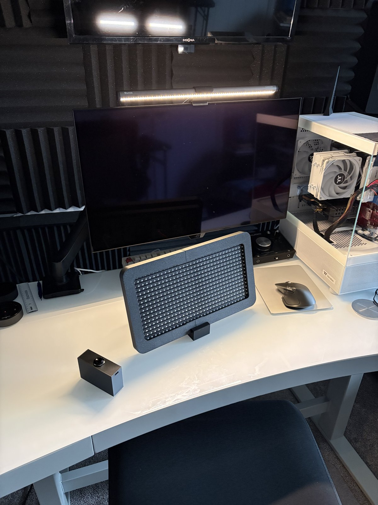
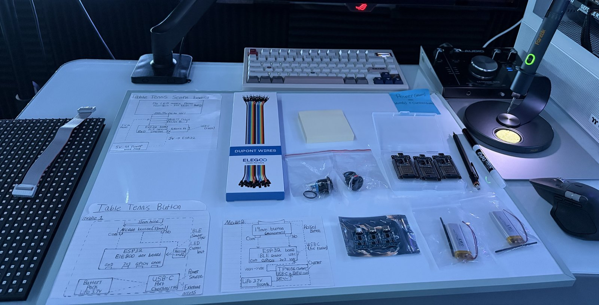
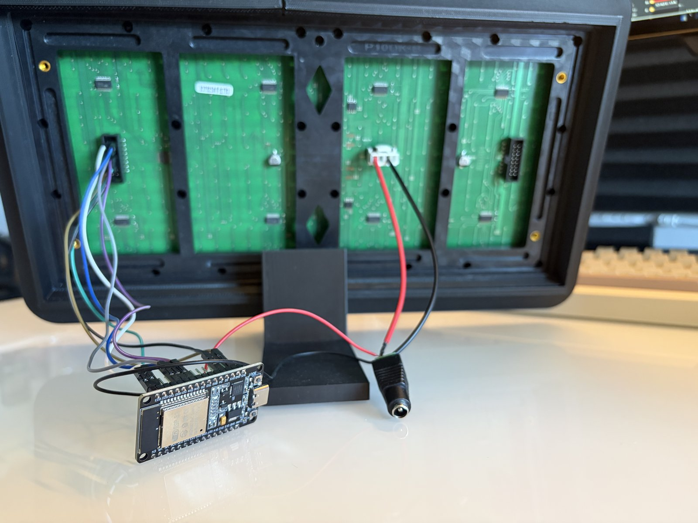
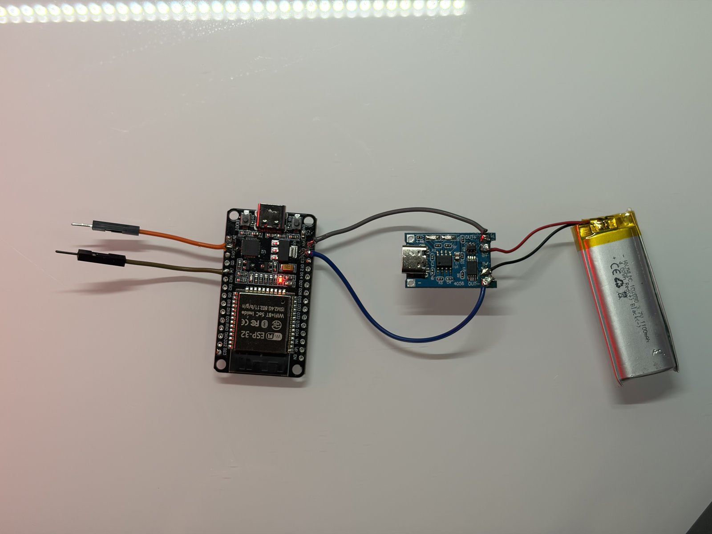

# ESP32 Wireless Ping-Pong Scoreboard

  

A three-device wireless scoreboard system built with ESP32 microcontrollers communicating over Bluetooth Low Energy (BLE). Two player buttons send score updates wirelessly to a central scoreboard display.

## System architecture

- **Scoreboard (receiver):** ESP32 wired to a P10 LED matrix panel, continuously scanning for BLE advertisements and updating the display when a player scores.
- **Player 1 button (sender):** ESP32 with a momentary button wired to GPIO 4. When pressed, the ESP32 broadcasts a BLE advertisement with the device name `P1_SCORE`.
- **Player 2 button (sender):** Identical to P1, but broadcasts `P2_SCORE`. Both buttons use the same firmware with a single `#define` changed at compile time.

The scoreboard increments the correct player's score based on which device name it sees in the advertisement.

## Why connectionless BLE?

Instead of pairing the buttons to the scoreboard over a persistent BLE connection, each button simply *advertises* its name when pressed. The scoreboard scans for advertisements and recognizes them by name.

This means:
- No pairing or connection state to manage.
- No reconnection logic when a device resets or goes out of range.
- Either button can be swapped, reset, or replaced without touching the scoreboard.
- Adding a third or fourth player unit in the future is trivial: just give it a new name.

For a scoreboard that needs to "just work" in the middle of a game, connectionless was the cleaner design.

## Handling the two-core problem

The scoreboard has to do two demanding things at the same time:
1. Continuously refresh the P10 LED matrix (the panel won't hold its own pixels, so it needs to be scanned constantly or it goes dark).
2. Continuously scan for BLE advertisements from the buttons.

Doing both on one core caused the display to flicker and the ESP32 to crash with `Guru Meditation` errors. The hardware timer driving the display was being starved by BLE.

The fix:
- **Core 0** runs a FreeRTOS task pinned to it that handles BLE scanning.
- **Core 1** runs the main loop and a hardware timer interrupt (`IRAM_ATTR triggerScan`) that refreshes the P10 panel.
- A `volatile bool scoreChanged` flag lets the BLE task signal the main loop to redraw the display, but only when the score actually changes.

This eliminated both the flicker and the crashes.

## Hardware

- 3× ESP32 development boards (ELEGOO ESP32 Dev Modules)
- 1× P10 single-color LED matrix panel (32×16 pixels)
- 2× 19mm metal momentary push buttons with screw terminals
- Per button: 1× TP4056 USB-C charger board and 1× 102050 LiPo (3.7 V, 1100 mAh)
- Jumper wires on the scoreboard (soldered wiring is a future step)

## Software

- Written in C/C++ on the Arduino framework
- ESP32 Arduino core 1.0.6 (compatible with the timer API used)
- [DMD32](https://github.com/Qudor-Engineer/DMD32) library for driving the P10 panel
- Built-in ESP32 BLE libraries (`BLEDevice`, `BLEScan`, `BLEAdvertising`)
- Font: `Arial_Black_16` from DMD32

## Enclosure and stand

Every printed part is a **parametric Python script**: the frame and stand in **Fusion 360**, the button case in **CadQuery**. Dimensions live as tunable constants at the top of each file, so a part can be re-cut for a different panel or printer tolerance without redrawing anything.

<p align="center">
  
  
</p>

| Part | Script | Notes |
|---|---|---|
| Stand | `cad/stand/stand.py` | Grooved cradle, 12° back tilt. Print one for the middle, or two, one under each end of the frame |
| Left half | `cad/left_half/left_half.py` | Slotted side panel, printed front face down |
| Right half | `cad/right_half/right_half.py` | Closed rounded end, widened 15.3 mm in v2 to close the measured seam gap |
| Button case | `cad/button_enclosure/button_enclosure.py` | CadQuery. Slide-panel tower, 32 × 95 × 58 mm, USB-C slot, side panel with pull tab. 3MF and STL included |

To run a Fusion part: go to **Utilities → Add-Ins → Scripts and Add-Ins**, click **+**, pick the part folder, then **Run**. The button case runs in CadQuery, or print the included 3MF/STL directly.

## Wiring

#### Scoreboard

<p align="center">
  <a href="docs/images/wiring/05-esp32-to-p10-led-panel-wiring.png"></a>
  <a href="docs/images/photos/05-esp32-to-p10-panel-photo.jpg"></a>
  <br><em>ESP32 to P10 panel, HUB12 pinout (left) and the real build (right)</em>
</p>

#### Button

<p align="center">
  <a href="docs/images/wiring/04-power-system-lipo-tp4056-esp32.png"></a>
  <br><em>Button power: ESP32 VIN to TP4056 OUT+, LiPo on B+/B-, button on D4. Click for full size</em>
</p>

<p align="center">
  
  <br><em>The real thing: ESP32, TP4056 charger, 1100 mAh LiPo</em>
</p>

## Repository structure

```
.
├── Scoreboard/
│   └── Scoreboard.ino           # receiver: BLE scan + display
├── ButtonSender_P1/
│   └── ButtonSender_P1.ino      # player 1 button
├── ButtonSender_P2/
│   └── ButtonSender_P2.ino      # player 2 button (PLAYER = "P2_SCORE")
├── cad/
│   ├── stand/                   # Fusion 360
│   ├── left_half/               # Fusion 360
│   ├── right_half/              # Fusion 360
│   └── button_enclosure/        # CadQuery + 3MF + STL
└── docs/images/
    ├── renders/                 # CAD renders
    ├── wiring/                  # wiring diagrams
    ├── photos/                  # build photos 
    └── button/                  # button enclosure photos and renders
```

## What's working

- Three-device BLE communication end-to-end.
- Stable display refresh with no flicker during BLE scanning.
- Scores 0-99 display correctly for both players on the P10 panel, double digits included.
- Long press to reset the scoreboard to 0 - 0.
- Software debouncing on the scoreboard (800 ms window) filters out rapid repeat advertisements from the same button press.

## Known issues and to-do

- **No negative-scoring or correction gesture.** Original design called for double-tap = -1. Not yet implemented.
- **No deep sleep on the button units.** They run continuously, which drains the LiPo. Both senders need to sleep between presses and wake on a GPIO interrupt.

## Next steps

1. Implement the negative-score gesture on the sender firmware.
2. Add deep sleep or on/off switches on the buttons.
3. 3D print the button enclosures.
4. Solder permanent connections between the scoreboard ESP32 and the P10 panel.
